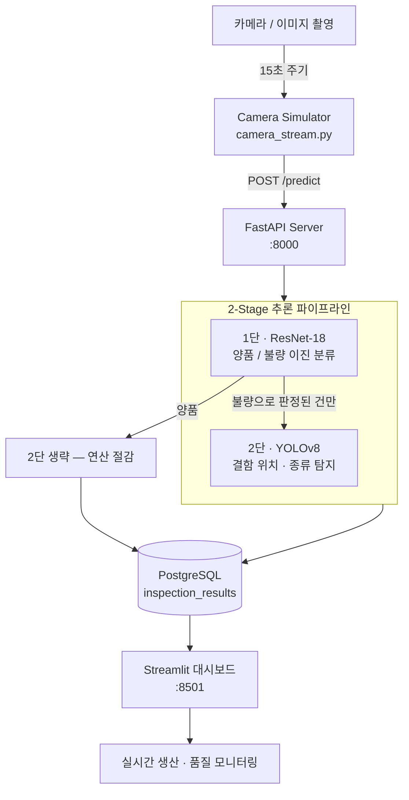

# Smart Factory Vision AI 🚗

자동차 생산 라인에서 **자동차 도어 이미지를 실시간 분석하여 불량 여부를 판별**하고 결함 위치를 추적하는 AI 비전 시스템입니다.
본 시스템은 **초고속 이진 분류(ResNet)**와 **정밀 결함 탐지(YOLO)**를 결합한 **2-Stage 파이프라인**을 통해 대규모 이미지 처리의 효율성과 탐지 정확도를 동시에 확보합니다.

> **개인 학습 프로젝트입니다.**
> 공개 데이터셋으로 모델을 학습했고, 실제 생산 라인이 아니라 **가상의 라인 조건을
> 가정한 시뮬레이션**입니다. 카메라 대신 `camera_simulator` 가 일정 주기로 이미지를
> 전송하는 구조이며, 실제 설비와 연결되어 있지 않습니다.
>
> 목적은 모델 성능 자체보다 **라인 속도라는 제약에서 검사 주기를 역산하고,
> 그 주기 안에 추론이 끝나도록 연산을 배분하는 설계**를 해 보는 것이었습니다.

---

## 1. 프로젝트 개요

### 1.1 배경 및 목적
자동차 제조 공정의 품질 검사는 높은 정밀도와 실시간성을 요구합니다. 기존의 인력 중심 검사 방식의 한계를 극복하기 위해, 본 프로젝트는 다음과 같은 목표를 가집니다.
- **실시간 탐지**: 생산 라인의 흐름을 방해하지 않는 고속 분석.
- **정밀 시각화**: 결함의 종류(스크래치, 손상 등)와 위치를 정확히 표시.
- **데이터 기반 관리**: 검사 결과를 데이터베이스화하여 품질 관리 고도화.

---

## 2. 생산 라인 사양 및 설계 근거

본 시스템은 실제 자동차 생산 환경을 가정한 시나리오를 바탕으로 설계되었습니다.

### 2.1 도어 규격 및 속도
- **자동차 도어 평균 규격**: 약 1.2 m × 1.0 m
- **컨베이어 벨트 속도**: 약 3 m/min ~ 6 m/min (0.05 m/s ~ 0.1 m/s)
- **검사 구간 통과 시간**: 약 12~24초

### 2.2 15초 주기 분석 설정의 근거

검사 주기는 임의로 정한 값이 아니라 **라인 속도에서 역산한 값**입니다.

| 항목 | 값 | 산출 |
| --- | --- | --- |
| 도어 규격 (진행 방향) | 1.2 m | 평균 규격 |
| 컨베이어 속도 | 0.05 ~ 0.1 m/s | 3 ~ 6 m/min |
| 검사 구간 통과 시간 | **12 ~ 24초** | 1.2 m ÷ 속도 |
| **설정 검사 주기** | **15초** | 최소 통과시간(12초) 이내 |

주기를 **최소 통과시간보다 짧게** 잡아야 가장 빠른 라인 속도에서도 도어 한 장이
촬영되지 않고 지나가는 일이 없습니다. 반대로 너무 짧게 잡으면 같은 도어를 중복
촬영해 연산이 낭비됩니다. 15초는 이 두 제약 사이에서 고른 값입니다.

> 실제 시뮬레이터(`camera_simulator/camera_stream.py`)의 기본값은 `INTERVAL_SECONDS = 12`
> 로, 최악 조건(6 m/min)에서도 누락이 없도록 더 보수적으로 설정되어 있습니다.

### 2.3 처리 시간 제약

검사 주기가 15초라는 것은 **1장당 추론이 15초 안에 끝나야 한다**는 뜻이기도 합니다.
이 제약이 2-Stage 구조를 택한 직접적인 이유입니다 — 모든 이미지에 고해상도(1024px)
YOLO를 돌리면 주기를 맞추기 어렵지만, 양품을 1단에서 걸러내면 평균 처리시간이
불량률에 비례해 줄어듭니다.

---

## 3. 시스템 아키텍처



**2단 파이프라인을 쓴 이유**는 연산량 배분입니다. 전수검사에서 대부분은 양품이므로,
가벼운 이진 분류로 먼저 걸러내고 **불량으로 판정된 건에만** 고해상도 탐지를 겁니다.
불량률이 *p* 일 때 YOLO 호출 횟수가 전체의 *p* 배로 줄어드는 구조입니다.

---

## 4. 기술 스택 (Tech Stack)

### 4.1 AI Training & Modeling
- **Hardware**: Google Colab T4 GPU
- **Framework**: PyTorch, Ultralytics (YOLOv8)
- **Library**: OpenCV, Pandas, Pillow
- **Optimization**: imgsz=1024, High-Res Training

### 4.2 System Interface
- **Backend**: FastAPI
- **Dashboard**: Streamlit
- **Database**: PostgreSQL
- **Infrastructure**: Docker Desktop (PostgreSQL)

---

## 5. 데이터 전처리 상세 (JSON to YOLO)

### 5.1 데이터 병합 및 해제
- **Tar 병합**: 외부 분할 압축 파일(`.tar.partX`)을 Windows `copy /b` 명령어로 병합합니다.
- **파일 매칭**: CSV 로그를 기반으로 원천 이미지와 JSON 라벨 데이터를 1:1 매칭합니다.

### 5.2 YOLO 좌표 정규화 수식
JSON 내의 절대 좌표(`[x, y, width, height]`)를 YOLO의 상대 좌표(`[class, x_center, y_center, w, h]`)로 변환합니다.
- `x_center = (x + width / 2) / Image_Width`
- `y_center = (y + height / 2) / Image_Height`
- `w = width / Image_Width`, `h = height / Image_Height`

---

## 6. AI 모델 사양

| 단계 | 모델 | 목적 | 모델 파일 경로 |
| :--- | :--- | :--- | :--- |
| **1단** | **ResNet-18 (Binary)** | 고속 양품/불량 이진 판별 | `model/best_defect_model.pth` |
| **2단** | **YOLOv8** | 결함 위치 정밀 탐지 | `runs/detect/best.pt` |

### 6.1 탐지 결함 클래스

`model/dataset_converter.py` 가 생성하는 `dataset.yaml` 기준 4종입니다.

| ID | 클래스 | 설명 |
| :--- | :--- | :--- |
| 0 | `Scratch` | 스크래치 |
| 1 | `Damage` | 손상 |
| 2 | `Step` | 단차 |
| 3 | `Sealing` | 실링 불량 |

### 6.2 YOLO 학습 설정 (`train_yolo_final.py`)

속도를 유지하면서 미세 결함 탐지력을 끌어올리는 방향으로 조정한 최종 설정입니다.

| 구분 | 파라미터 | 값 | 선택 이유 |
| :--- | :--- | :--- | :--- |
| 해상도 | `imgsz` | **1024** | 640 대비 미세 스크래치 탐지력 확보 |
| 배치 | `batch` | 8 | 고해상도에 맞춘 메모리 조정 |
| 학습량 | `epochs` / `patience` | 100 / 20 | 조기 종료로 과적합 방지 |
| 최적화 | `lr0` / `momentum` / `weight_decay` | 0.01 / 0.937 / 0.0005 | — |
| 증강 | `mosaic` | 1.0 | 배경 노이즈 강인성 |
| 증강 | `degrees` | 15 | **현장 카메라 설치 각도 편차 반영** |
| 증강 | `flipud` / `mixup` | 0.5 / 0.1 | 도어 좌우 대칭 품목 대응 |

증강 설정을 기본값으로 두지 않고 `degrees=15`, `flipud=0.5` 를 넣은 것은,
카메라가 라인마다 조금씩 다른 각도로 설치되고 좌/우 도어가 번갈아 들어오는
**현장 조건**을 학습 단계에서 흡수하기 위한 것입니다.

### 6.3 검사 결과 저장 구조 (`inspection_results`)

| 컬럼 | 타입 | 내용 |
| :--- | :--- | :--- |
| `product_id` | VARCHAR(50) | 제품 식별자 |
| `image_path` / `result_image_path` | TEXT | 원본 / Bbox 표시 결과 이미지 |
| `inspection_time` | TIMESTAMP | 검사 시각 (인덱스) |
| `quality` / `is_defective` | VARCHAR / BOOLEAN | 판정 결과 (인덱스) |
| `confidence` | FLOAT | 예측 신뢰도 |
| `defect_type` | VARCHAR(50) | 결함 종류 |
| `bbox` | **JSONB** | 결함 좌표 배열 |

결함이 한 장에 여러 개 나올 수 있어 좌표는 `JSONB` 배열로 저장하고,
조회가 잦은 `inspection_time` · `is_defective` · `product_id` 에 인덱스를 두었습니다.

---

## 7. 프로젝트 구조 및 실행 방법

### 7.1 디렉토리 구조 및 핵심 파일
```text
smart-factory-vision-ai
├─ model/
│  ├─ dataset_converter.py    # JSON 라벨을 YOLO 포맷(.txt)으로 변환
│  ├─ train_yolo_final.py     # Google Colab T4 최적화 YOLO 학습 스크립트
│  ├─ integrated_inference.py # ResNet(1단) + YOLO(2단) 통합 추론 로직
│  ├─ resnet_binary_model.pth # 1단계 양품/불량 판별용 사전 학습 모델
│  └─ inference_yolo.py       # YOLO 단독 테스트 및 추론용 스크립트
│
├─ api/
│  └─ fastapi_server.py       # 추론 요청 수신 및 2단계 파이프라인 실행 서버
│
├─ dashboard/
│  └─ streamlit_app.py        # 검사 결과 및 결함 위치 실시간 시각화 대시보드
│
├─ camera_simulator/
│  └─ camera_stream.py        # 15초 주기로 고해상도 이미지를 서버로 전송 시뮬레이션
│
├─ database/
│  ├─ schema.sql              # PostgreSQL 테이블 설계 (결함 좌표, 신뢰도 등)
│  └─ db_init.py              # 데이터베이스 구성 및 초기화 스크립트
│
├─ data/
│  └─ yolo_dataset/           # 변환이 완료된 YOLO 표준 학습 데이터셋
│
├─ docker-compose.yml         # PostgreSQL 데이터베이스 인프라 구성 (Docker)
└─ requirements.txt           # 프로젝트 실행을 위한 라이브러리 목록
```

### 7.2 실행 가이드
1. **인프라 시작**: `docker-compose up -d`
2. **DB 초기화**: `python database/db_init.py`
3. **서버 구동**: `python api/fastapi_server.py`
4. **대시보드 시작**: `streamlit run dashboard/streamlit_app.py`
5. **시뮬레이션**: `python camera_simulator/camera_stream.py`

---

## 8. 한계와 확장 방향

현재 구현은 **단일 검사 공정의 PoC** 이며, 아래는 의도적으로 남겨 둔 범위입니다.

| 한계 | 확장 방향 |
| :--- | :--- |
| 2-Stage 의 처리량 이득을 수치로 검증하지 않음 | 불량률 구간별 평균 추론시간 측정 → 주기 15초 충족 여부 정량 확인 |
| 1단 오탐(False Negative) 시 2단이 아예 실행되지 않음 | 1단 임계치와 전체 검출률의 트레이드오프 곡선 도출 |
| 전수검사 전제 | 로트 크기·불량률에 따른 **샘플링 검사 설계**(AQL) 와의 비용 비교 |
| 검사 결과가 공정으로 피드백되지 않음 | 불량 유형별 발생 추이 → 설비·공정 파라미터 조정으로 연결 |
| 라인 속도를 고정값으로 가정 | 속도 변동 시 검사 주기 동적 조정 |

특히 마지막 두 항목은 **검사를 품질 판정에서 끝내지 않고 공정 개선의 입력으로 쓰는**
방향으로, 제조시스템 운영 관점에서 이어서 다루고자 하는 부분입니다.

---
*본 프로젝트는 스마트 팩토리의 불량 비전 검사 시스템 실무 PoC를 목표로 합니다.*
